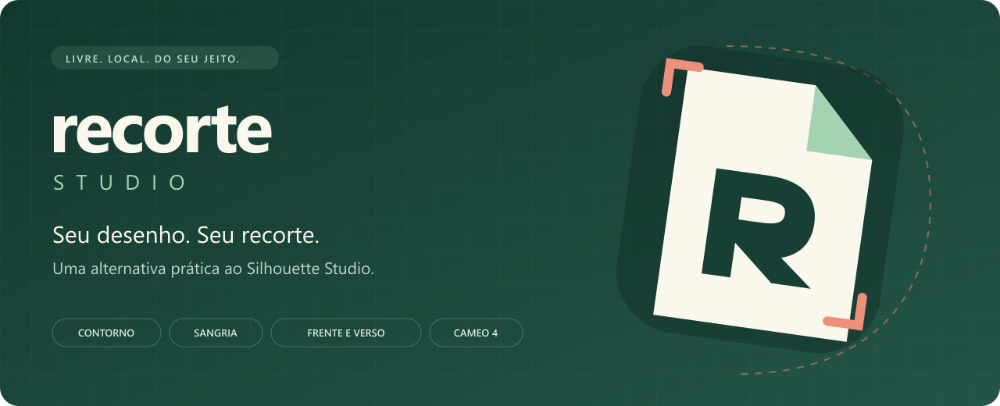
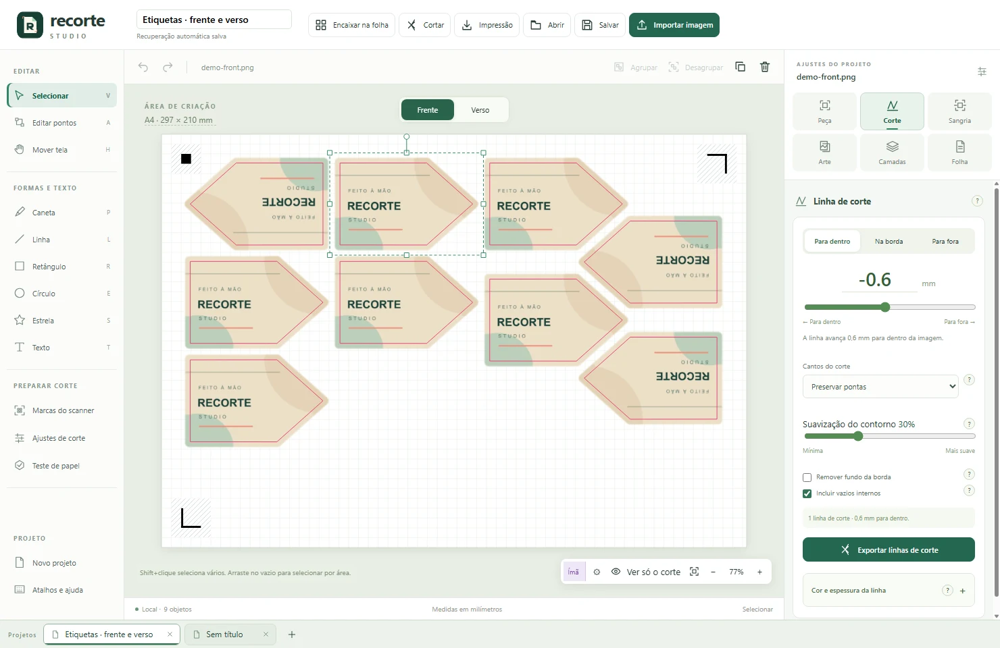
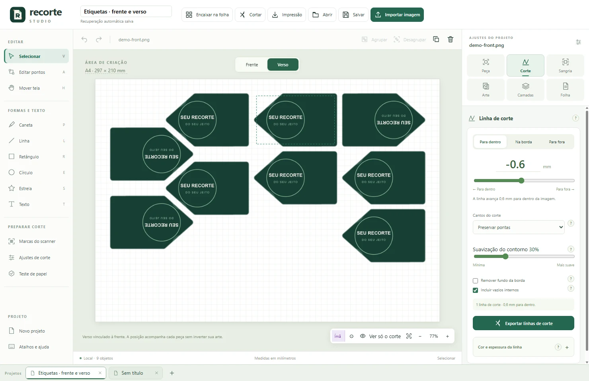
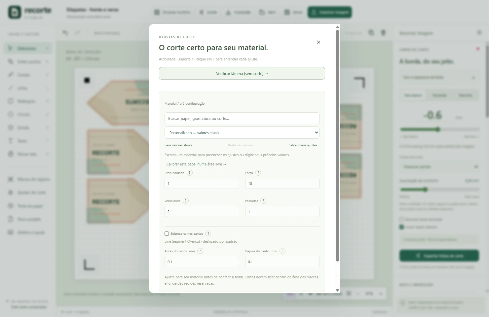
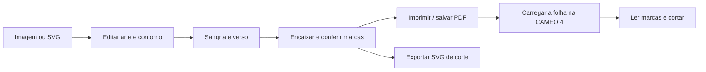

<div align="center">
  
  <h1>Recorte Studio</h1>
  <h3>Da imagem ao recorte. Com menos etapas e mais controle.</h3>
  <p>Contornos, sangria, frente e verso, organização da folha e corte na CAMEO 4.<br>Uma ferramenta local, aberta e feita para o trabalho de verdade.</p>
  <p>
    <a href="LICENSE"></a>
    <a href="https://github.com/eronGreco/Recorte-Studio/actions/workflows/ci.yml"></a>
    
  </p>
  <p>
    
    
    
    
  </p>
  <p><a href="#por-que-ele-existe">Por quê?</a> · <a href="#interface">Interface</a> · <a href="#o-que-muda-na-prática">Diferenciais</a> · <a href="#instalar-e-executar">Instalação</a> · <a href="#compatibilidade-e-estado-atual">Compatibilidade</a> · <a href="docs/README.en.md">English</a></p>
</div>

## Por que ele existe?

O objetivo do **Recorte Studio é substituir o uso do Silhouette Studio no meu fluxo de trabalho**: preparar a arte, definir o corte, montar frente e verso, aproveitar a folha e enviar o trabalho à máquina com uma interface mais prática.

Ele nasceu de problemas recorrentes no meu uso: funções básicas difíceis de encontrar, ajustes que exigiam etapas manuais demais, contornos internos que descaracterizavam a imagem e recursos úteis separados por edições pagas. Quero conseguir fazer uma etiqueta, uma tag ou uma peça frente e verso sem precisar lutar com o programa.

É um projeto feito primeiro para as minhas necessidades. Talvez elas sejam parecidas com as suas. Por isso o código está aberto: para usar, entender, adaptar e melhorar.

**A prioridade é UI/UX.** Opções precisam aparecer no contexto certo; medidas precisam ser fáceis de editar; e o resultado precisa ser visível antes de imprimir ou cortar.

> [!NOTE]
> **Em desenvolvimento ativo.** O foco atual é Windows + CAMEO 4 por USB, com AutoBlade no suporte 1 e folha A4. O código-fonte pode ser executado seguindo as instruções abaixo; ainda não há instalador publicado. A compatibilidade com outros equipamentos precisa de contribuição e validação física.

## Interface



<table>
  <tr><th width="50%">Frente e verso vinculados</th><th width="50%">Ajustes de corte no mesmo fluxo</th></tr>
  <tr>
    <td></td>
    <td></td>
  </tr>
</table>

As imagens mostram o aplicativo real com artes de demonstração incluídas no repositório. Seus projetos, impressões e registros de máquina ficam no seu computador.

## O que muda na prática

### ✂️ O contorno acompanha a intenção do corte

- Trace imagens automaticamente e escolha uma margem **para dentro ou para fora**, em milímetros.
- Controle a **suavização** com um slider para reduzir serrilhados de imagem raster.
- Escolha **preservar pontas ou arredondar cantos**. Suavizar não precisa transformar um encontro em V numa curva.
- Inclua ou ignore vazios internos e ajuste a remoção do fundo conectado à borda.
- Mude a cor e a espessura visual da linha de corte sem alterar a geometria enviada à máquina.

### 🎨 Sangria simulada sem refazer a arte

Crie uma margem extra que **prolonga as cores próximas à borda e aplica desfoque controlável**, acompanhando o contorno da peça. Ela ajuda a evitar filetes brancos quando há pequenas diferenças entre impressão e corte.

A sangria pode acompanhar a frente e o verso. Ela é gerada localmente a partir da imagem; não depende de um serviço de IA nem de envio da arte para a nuvem.

### 🔁 Frente e verso que continuam ligados

Associe uma arte de verso a cada peça. Ao duplicar, mover, girar ou organizar as frentes, os versos acompanham as posições correspondentes do outro lado da folha, **mantendo a escrita legível**.

- Virada lateral ou por cima, com ajuste fino de deslocamento X/Y.
- PDF com as duas faces e exportação independente de cada face.
- Marcas ópticas na frente, sem criar cortes duplicados no verso.
- Guias de alinhamento e seta de recolocação para ajudar na impressão manual frente e verso.

### 🧩 Organização da folha com espaço para o scanner

O encaixe automático experimenta as orientações configuradas e procura aproveitar a área disponível. Considera o contorno, a distância entre peças, a sangria e as reservas das marcas de registro.

**O que não couber fica ao lado da folha.** As peças não são apagadas nem empilhadas umas sobre as outras. O encaixe usa uma heurística; não promete uma solução matemática ótima.

As margens de proteção do scanner e o fundo branco em volta das marcas são configuráveis. O padrão protege as regiões necessárias à leitura.

### 🕳️ Formas geométricas são cortes de verdade

Desenhe círculos, retângulos, estrelas e caminhos vetoriais para criar cortes e furos. Um círculo para passar um cordão é um contorno vetorial, sem precisar rasterizar e traçar novamente.

Furos podem ficar vinculados à peça, acompanhando suas transformações e cópias.

### 🧲 Edição precisa, sem esconder os controles

- Alinhamento magnético com guias para encontrar centros e bordas ao arrastar.
- Caixa de seleção que acompanha a rotação da peça.
- Ângulo e tamanho editáveis junto à transformação: **digite e confirme com Enter ou ✓**.
- Proporção mantida por padrão, com opção de redimensionar os eixos separadamente.
- Camadas com organização, visibilidade e bloqueio; agrupamento, duplicação e desfazer/refazer.
- Troca da arte de uma peça preservando sua montagem; mudança de silhueta pede confirmação.

### 🎛️ Materiais e calibração no papel que você já tem

Força, velocidade, profundidade da lâmina, passadas e **sobrecorte de segmentos — line segment overcut** ficam acessíveis com explicações simples.

Escolha um material pela busca de predefinições, ajuste os valores depois e salve suas próprias configurações. Há opções de papel fotográfico glossy **não adesivo**, incluindo frente e verso de 220 g/m²; são pontos de partida para calibração, não valores universais para qualquer marca e lâmina.

No **Teste de papel**, você delimita uma região livre da folha. O programa prepara seis pequenos hexágonos A–F com combinações de corte, lê as marcas e envia **somente os testes**. Depois você escolhe o melhor, ou informa que ficou raso ou profundo para tentar outra rodada.

As regiões usadas ficam registradas. Uma nova rodada pede outra área; quando uma tentativa falhou antes de cortar corretamente, há uma opção explícita de reutilização.

### ⚙️ Corte direto e trabalho em segundo plano

A comunicação com a CAMEO 4 usa o driver USBPRINT nativo do Windows. O envio conserva uma cópia preparada do trabalho, enquanto o editor continua disponível.

A pausa e a parada pelo programa acontecem **entre passadas completas**. A retomada relê as marcas antes de continuar. Para interromper imediatamente o movimento, use o controle físico da máquina. A pausa/retomada ainda precisa de validação física completa nesta integração.

## E os recursos atrás de paywall?

No Recorte Studio, os recursos implementados ficam na mesma ferramenta, sob licença MIT, sem conta, assinatura ou separação em edições pagas.

Para situar a comparação: segundo a documentação da Silhouette, abrir SVG e gerenciar camadas exige **Designer Edition ou superior**, enquanto salvar SVG exige **Business Edition**. Aqui, importar/exportar SVG e trabalhar com camadas já fazem parte do editor.

Fontes da comparação: [recursos da Designer Edition](https://silhouetteamerica.freshdesk.com/support/solutions/articles/35000273383-designer-edition-features) e [recursos da Business Edition](https://silhouetteamerica.freshdesk.com/support/solutions/articles/35000273385-business-edition-features). As edições do software oficial podem mudar; a comparação está limitada aos recursos citados.

## Do arquivo ao recorte



## Instalar e executar

### Requisitos

- **Windows 10/11**, ambiente atual de uso e testes.
- **Node.js 24 LTS**, com npm.
- **Python 3.12 ou superior** para a comunicação USB e os testes do worker. O worker usa somente a biblioteca padrão.
- Para o corte direto: CAMEO 4 conectada por USB, driver USB Printing Support do Windows e AutoBlade no suporte 1.

```powershell
git clone https://github.com/eronGreco/Recorte-Studio.git
cd Recorte-Studio
npm ci
npm start
```

Se o Python não estiver no PATH, informe o executável antes de abrir o programa:

```powershell
$env:RECORTE_PYTHON = 'C:\caminho\para\python.exe'
npm start
```

O editor não precisa do Python para editar e exportar. O corte usa acesso exclusivo ao USB: feche outros programas que estejam usando a CAMEO. Não é necessário trocar o driver por Zadig.

Mais detalhes: [primeiros passos](docs/PRIMEIROS-PASSOS.md) · [comunicação e hardware](hardware/README.md).

## Primeiro projeto

1. **Importe a arte** ou abra [`test/fixtures/demo.recorte`](test/fixtures/demo.recorte).
2. **Defina a medida e o contorno.** Ajuste a margem, a suavização e o tipo de canto na prévia.
3. **Associe o verso e a sangria**, quando precisar.
4. **Encaixe na folha** e confira as áreas das marcas de registro.
5. **Imprima em tamanho real / 100%.** Fixe a folha na base e carregue na máquina.
6. **Calibre o material numa área livre** e envie o corte com os ajustes escolhidos.

O projeto `.recorte` guarda a montagem editável. O SVG pode conter apenas as linhas de corte ou a arte de impressão, conforme a exportação escolhida.

## Compatibilidade e estado atual

- **Editor:** imagens raster, SVG, formas, texto, camadas, sangria, frente e verso e organização da folha.
- **Entrada raster:** PNG, JPEG, WebP e TIFF são tratados pelo decodificador; outros formatos dependem do suporte do Sharp. Imagens com várias páginas/quadros usam a primeira imagem.
- **Saída:** projeto `.recorte`, SVG e PDF de impressão frente e verso.
- **Corte direto:** CAMEO 4, Windows USBPRINT, A4 retrato/paisagem, AutoBlade no suporte 1. Há corte de produção confirmado em uma CAMEO 4; outras máquinas e configurações precisam de validação própria.
- **Ainda sem suporte:** arquivos `.studio3`, importação de PDF como documento editável, Bluetooth e envio a outros modelos de plotter.
- **Outros sistemas operacionais:** não são anunciados como suportados nesta versão. O transporte USB atual é específico do Windows.

As rotinas têm testes de geometria, interface, exportação e comunicação simulada. Testes automatizados não substituem a conferência física da impressão, da lâmina e do material.

## Privacidade e arquivos locais

O processamento é local. O aplicativo não exige login, conta na Silhouette ou upload das artes. A recuperação automática, as predefinições pessoais e o histórico de máquina ficam em `data/`; os projetos salvos por padrão ficam em `projetos/`. Essas pastas são ignoradas pelo Git.

## Desenvolvimento

```powershell
npm test              # geometria, preparação de trabalhos e worker Python, sem USB
npm run test:ui       # testes Electron com equipamento simulado
npm run test:all      # as duas suítes
npm run brand         # recria PNGs e ICO a partir dos SVGs do logo
```

Os testes usam perfis próprios em `.test-output/`, separados dos seus projetos. A CI executa as suítes de unidade e de interface no Windows.

O aplicativo usa **Electron, Paper.js, Clipper, Sharp e pdf-lib**. A interface e a geometria são JavaScript; a comunicação USB nativa roda num worker Python isolado. Veja [arquitetura](docs/ARQUITETURA.md) e [dependências](THIRD_PARTY_NOTICES.md).

## Contribuir

Encontrou um problema? [Abra uma issue](https://github.com/eronGreco/Recorte-Studio/issues/new/choose) com os passos para reproduzir e, quando possível, um exemplo sem informações pessoais.

São especialmente bem-vindas contribuições de **UI/UX, qualidade dos contornos, aproveitamento da folha, acessibilidade e validação de outros equipamentos**. Para hardware, informe modelo, firmware, sistema e o que foi efetivamente testado.

Leia [CONTRIBUTING.md](CONTRIBUTING.md). A lista de próximos passos está em [ROADMAP.md](ROADMAP.md).

---

Feito por **[Eron Greco](https://github.com/eronGreco)** · [Licença MIT](LICENSE)

Projeto independente. Silhouette Studio e CAMEO são marcas de seus respectivos titulares; o Recorte Studio não é um produto oficial da Silhouette America.
